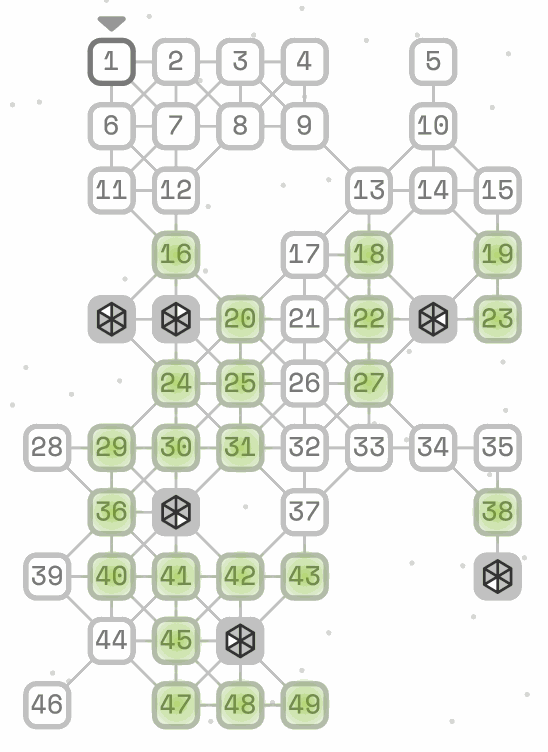
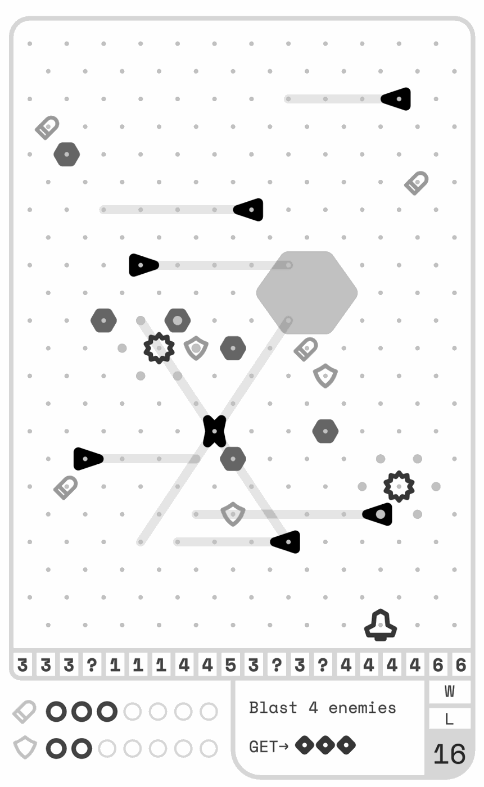
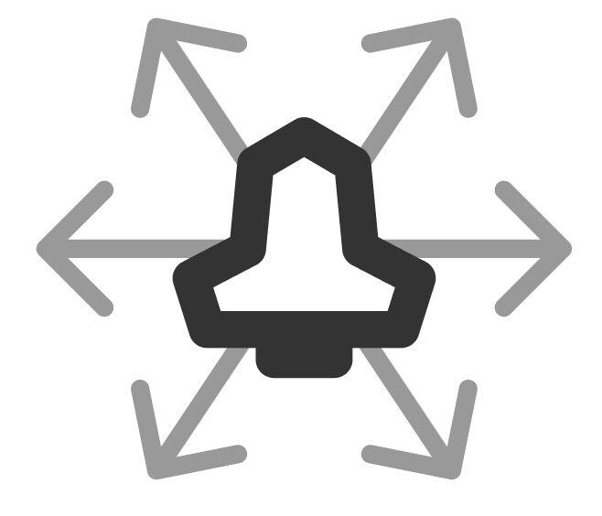
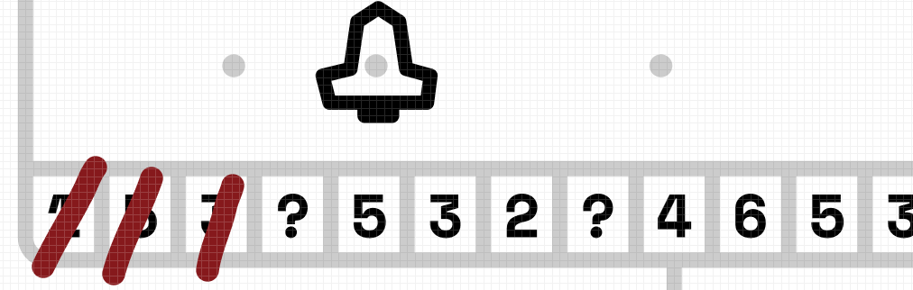
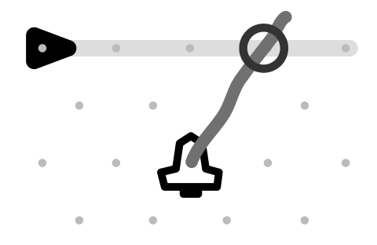

<h1>Galaxy rules</h1>

You need this notebook, a pencil, and a d6. Come in, pilot! Your warp drive has malfunctioned and you have been stranded in an unknown galaxy. Traverse the galaxy and locate all 6 pieces of your warp drive to return home. Completionists can visit every sector for more prestige.

<h2>Setup</h2>

<ol>
  <li><strong>Pilot I.D.</strong> Draw a profile of your character and choose a race. Members of your own race treat you slightly better when you meet them.<figure class="rule-pic small"></figure></li>
  <li><strong>Find your start.</strong> A small arrow on the map points to your starting sector.<figure class="rule-pic"></figure></li>
  <li><strong>Cross it off.</strong> After you play a sector, win or lose, return to the map and cross that sector off.</li>
  <li><strong>Travel on.</strong> You may enter any sector connected to a completed sector.</li>
  <li><strong>Collect a warp drive piece.</strong> Complete every sector connected to a warp drive piece to collect it. You will also need to clear the sectors that get you there.</li>
</ol>

<aside class="callout">
<strong>Tip.</strong> In most notebooks you play the majority of levels just to collect the warp drive pieces. Playing every sector is recommended.
</aside>

<h2>Playing a sector</h2>

<ol>
  <li><strong>Read the page.</strong> The top is the sector map. Your ship  always starts on the bottom row. Below the map is the Flight Computer, your movement values for this sector. Bottom left: missile and shield counters. Bottom right: the mission, the reward, Win or Loss, and the sector number.<figure class="rule-pic"></figure></li>
  <li><strong>Asteroid.</strong> Shoot one to clear the space, or fly through it and lose a shield. Finish the full move even if you hit one.</li>
  <li><strong>Wormhole.</strong> Two ends. Enter one and jump to the other, then keep going the same direction for any spaces you have left. Wormholes can be used more than once.</li>
  <li><strong>Mine.</strong> Come within one space and it explodes, using one shield. You may also shoot it. Anything within one space of the blast — enemy, asteroid, or another mine — is destroyed. Finish your move even if you hit one.</li>
  <li><strong>Credit.</strong> Pass over a credit and note it. Spend it after the sector, win or lose.</li>
  <li><strong>Shield pickup.</strong> Outline a new circle in this sector’s shield counter.</li>
  <li><strong>Missile pickup.</strong> Outline a new circle in this sector’s missile counter.</li>
  <li><strong>Move.</strong> Each Flight Computer value is how many spaces you travel. Pick one of the 6 directions, draw the line, and mark your new spot with a small circle. You cannot turn mid-move. Cross off each value as you use it. You may skip a number and still cross it off. You may not skip a ?. A ? means roll the d6 for the distance. You may cross your own path.<figure class="rule-pic small"></figure><figure class="rule-pic wide"></figure></li>
  <li><strong>No legal move.</strong> If a value has no possible direction, skip to the next value. If you rolled and truly cannot move, cross out that roll and continue. If the only move is a bad one, you still take it.</li>
  <li><strong>Fire.</strong> Between moves, not during one, you may fire as many missiles as you still have. Fire in the same 6 directions you move, so line up first. Cross out the missile before you roll. It is spent even on a miss.<figure class="rule-pic wide"></figure></li>
  <li><strong>Roll to hit.</strong> Count the spaces between your ship and the enemy. Roll that number or higher on the d6. One space away is an automatic hit. Cross out a destroyed enemy. You may fly through that space, and it can no longer shoot you.<figure class="rule-pic small"></figure></li>
  <li><strong>Get shot.</strong> An enemy fires whenever your move crosses its range. Roll the d6 for the enemy. A roll equal to or higher than the distance is a hit. Cross out a shield. No shields left means you lose the sector. Enemies can see and shoot through asteroids.<figure class="rule-pic small"></figure><figure class="rule-pic wide"></figure></li>
  <li><strong>Score it.</strong> Each sector asks you to destroy a set number of enemy ships or retrieve an item. Do that without losing all your shields or fuel, then mark W in the Win or Loss box and stop. Otherwise mark L. Running out of Flight Computer values before the objective means you are out of fuel and lose the sector, so skip numbers carefully.</li>
</ol>

<aside class="callout">
<strong>Tip.</strong> Shields and missiles you pick up do not carry to the next sector. Most objects are single use. Wormholes are the exception.
</aside>

<h2>Winning</h2>

A sector is over as soon as you meet its objective. Do not take more turns. If you won, take the credits shown, then spend them immediately in the upgrades shop or on a prestige rank. If you lost, keep only the credits you picked up on the map, spend those immediately, and mark a lost ship on the Game Stats page. Then return to the galaxy map and choose the next connected sector. Collect all 6 warp drive pieces to return home.

<h2>Upgrades</h2>

<figure class="rule-pic"></figure>

<ol>
  <li><strong>Spend a credit.</strong> For each credit, fill in the next upgrade space, in order.</li>
  <li><strong>Double Shot.</strong> When you fire a missile, you get 2 rolls to hit. This does not help enemies shooting at you.</li>
  <li><strong>Battering Ram.</strong> Fly through asteroids as if they are not there.</li>
  <li><strong>Nav-Control.</strong> On a ? in the Flight Computer, choose a movement of 1 to 6 instead of rolling.</li>
  <li><strong>Extra Starting Shields.</strong> Begin each sector with 1, then 2, then 3 extra shields. Earn these in order.</li>
  <li><strong>Extra Starting Missiles.</strong> The same, for missiles. Earn these in order.</li>
  <li><strong>Missile Range.</strong> Add 1, then 2, to your roll to hit. Earn these in order.</li>
</ol>

<h2>Game stats and prestige</h2>

<figure class="rule-pic"></figure>

Credits can also buy ranks. Ranks are only for fun and challenge. The Game Stats page can hold your contact info, when the campaign started and ended, and a tally of every ship lost in the galaxy.

<h2>Space monsters</h2>

<figure class="rule-pic"></figure>

<ol>
  <li><strong>Roll.</strong> Roll the d6, then choose a row or a column of that number that contains a space monster. You only need to match the row or the column, not both.</li>
  <li><strong>Cross one out.</strong> Cross out one monster on that row or column.</li>
  <li><strong>Score it.</strong> You get 8 rolls. Earn one credit for each monster you hit. These are extra upgrade tokens.</li>
</ol>

<aside class="callout">
<strong>Tip.</strong> An alien encounter usually grants an upgrade that lasts only for the next normal sector, or a credit reward you spend immediately.
</aside>

<figure class="rule-pic"></figure>

Good luck, Pilot!

Tom Brinton, Game Designer. This rule guide was found at www.gladdendesign.com.
