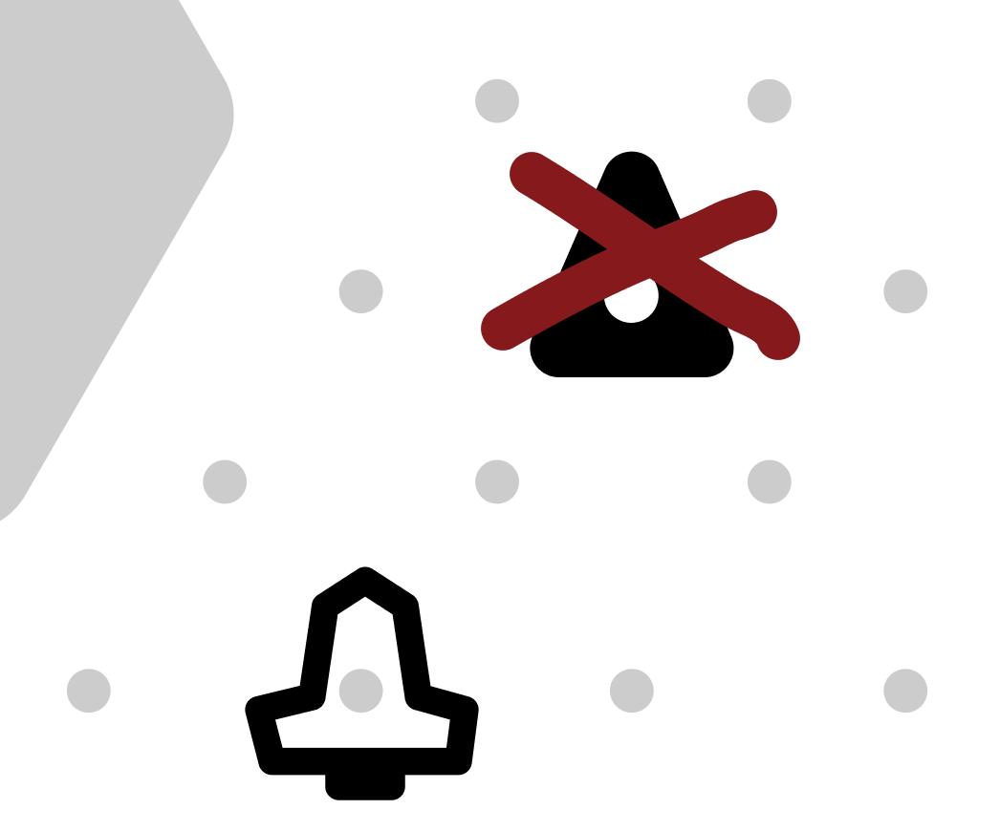
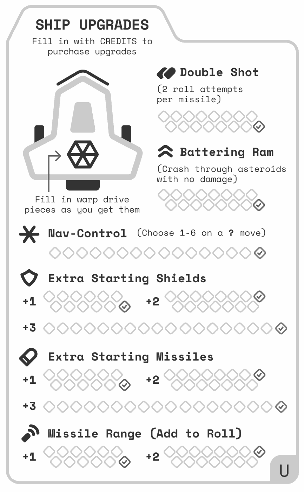
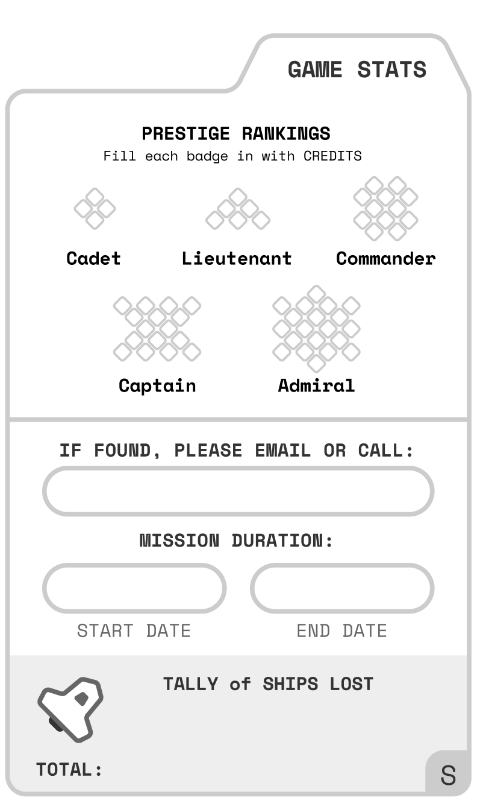
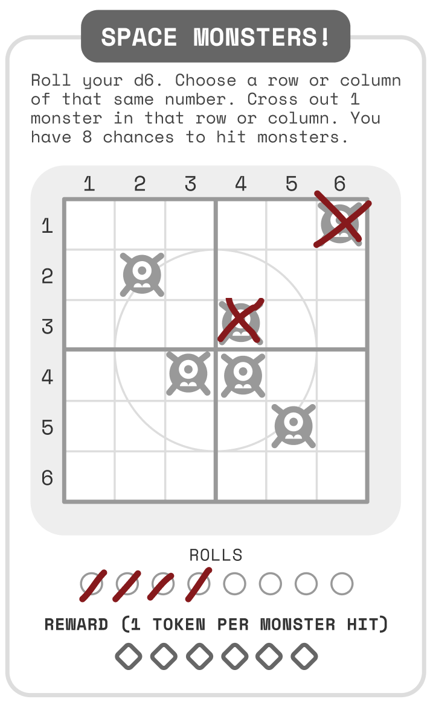
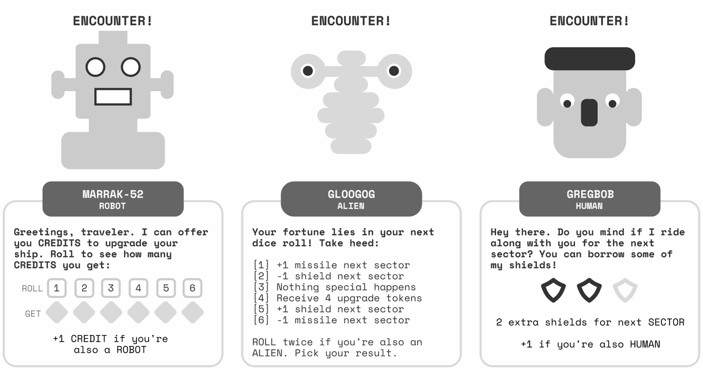

* STATIC *

Come in, pilot! Your warp drive has malfunctioned and you have been stranded in an unknown GALAXY! 

Your goal:

Traverse the GALAXY and locate all 6 pieces of your Warp Drive in order to return home. Completionists can visit every sector to attain more prestige.

You&rsquo;ll begin by filling out your Pilot I.D. card. Draw a profile of your character and choose a race. Bear in mind that you&rsquo;ll get slightly preferential treatment from members of your own race that you encounter throughout the game.

How to use the MAP:

A small arrow will point to your starting SECTOR. Once you have played that sector (win or lose) you will return to the map and cross it off as completed. You can then proceed to the next sector and continue playing. Note that you can travel to any sector connected to a completed sector.

Getting Warp Drive Pieces:

You must complete every sector connected to a Warp Drive Piece to &ldquo;collect&rdquo; that piece. In this map example, I&rsquo;ve highlighted every sector that would have to be completed to collect all the Warp Drive Pieces. Obviously you would need to complete other sectors in order to get to these in the first place. 

As you can see, in most notebooks, you&rsquo;ll play the majority of levels just to collect the Warp Drive Pieces. I, of course, recommend playing all the sectors!

Understanding the SECTOR layout:

The top section of the page is the sector map. Your ship will always be located on the bottom row. We will talk about each object on the map in the next section.

Below the map is the Flight Computer, these are your movement values for this sector.

In the bottom left are your missile and shield counters. 

In the bottom right is your mission and reward, with an area to mark Win or Loss. Also the sector number is found in this section.

SECTOR Objects:

This is your ship. Start your movement here.

This is an asteroid. You may shoot asteroids to allow you to travel through the space they occupy. You may also fly through an asteroid, but you will lose a shield. Complete your full move, even if you hit an asteroid.

This is a wormhole. When and if a wormhole appears, it will have two ends. This allows you to &ldquo;jump&rdquo; to the location of the other wormhole when you travel through it. You keep moving the same direction and move any remaining spaces.

This is a mine. If you travel within one space of a mine, it explodes, using up one of your shields. You can also shoot it to detonate it. Anything (like an enemy, asteroid or even another mine) within 1 space of it is also destroyed. You should still complete your move even if you hit a mine.

This is a credit pickup. If you pass over a credit pickup, make note of it. You can spend it after this sector, win or lose.

This is a shield pickup. If you travel over one of these, outline a new circle in your shield counter for that sector. 

This is a missile pickup. If you travel over one, outline a new circle in your missile counter.

Note: Shields and Missiles that you pick up are not carried over between sectors.

Note: Most items that you encounter in a sector are &ldquo;single use&rdquo; meaning you can only interact with it once. Exceptions are wormholes which can be used repeatedly.

Maneuvering your SHIP:

The values along the bottom of each sector (the &ldquo;Flight Computer&rdquo;) tell you how many spaces to move your ship. You may select which direction to move. Cross off the values as you go. You may skip a value, but you must still cross it off. You may not&nbsp;skip ? values. These mean that you must roll your d6 to determine movement distance.

You can move in the 6 directions shown here. Draw a line to map out your movement, and a small circle at your new location to help you keep track of where you are. You may cross over your path as much as needed.

Some things to keep in mind when moving: You can&rsquo;t turn during a move. You must travel in a straight line in your chosen direction. Rarely there are no possible moves with the given value. Try skipping to the next value. If you rolled a movement value, and there are really&nbsp;no possible directions to go, then you can cross that out and move on to a value that works. Note: Even if the only possible move puts you in a tough situation, you must still take it. That&rsquo;s life in outer space.

IF you run out of moves on your Flight Computer without completing your stated mission objective, you have run out of fuel and Lose that sector. So be judicious with how many numbers you choose to skip!

Battling ENEMIES:

You will encounter many enemies throughout your adventure, and often your objective is to destroy a certain amount of enemy ships to clear a sector.

Attacking:

First we will cover how you attack enemies. Between movements (not during) you may fire missiles. You may fire as many as you choose, as long as you have missiles left. You fire missiles in the same 6 directions in which you move, so make sure you are aligned with an enemy before firing.

When firing a missile, first&nbsp;cross it out in your missile counter. Missiles are used whether they hit or not.

Now, count the number of spaces between your ship and the enemy ship. You must roll this value or higher with a d6 in order to score a hit.

In this example, your ship is 2 spaces away from the enemy ship, so you must roll 2 or higher. The roll was successful, so the enemy ship is destroyed. Cross it out. You may now fly over that space, and the enemy can no longer fire at you.

Note: If you are only 1 space away from an enemy, there is no need to roll as that is a direct hit every time. Positioning is important!

Being Attacked:

Enemy ships have a bad attitude and will fire at you anytime you cross through their firing range. Although they will not always hit you!

In this example, the movement of your ship has crossed the enemy&rsquo;s range at a distance of 3. You roll your d6 for the enemy&nbsp;to determine if they score a hit. So if you roll a 3 or higher, they hit you.

If you were hit, cross out a shield in your shield counter. If you are hit and have no&nbsp;shields&nbsp;left, then you lose that sector.

Note: Enemies can see through asteroids, and fire through them as well. So unfair!

Winning or Losing a Sector:

Each sector has a stated objective of either blasting a certain amount of enemy ships, or retrieving an item. If you achieve this mission without running out of shields, or running out of fuel, then you mark W for Win. Otherwise, mark L for Loss. Once you achieve your objective, the sector is complete&mdash;don&rsquo;t take any more turns! 

If you won, you receive CREDITS. These should be spent right away in the upgrades shop, or toward earning a prestige ranking.

If you lost, you only keep any credits that you picked up on the map. These should also be spent right away. You can also mark a lost ship in the Game Stats page.

After spending CREDITS, return to the Galaxy MAP and determine which sector you will play next.

Upgrading your SHIP:

As you earn credits, many of them will be spent upgrading your ship. For each credit you earn, fill in a space, in order. Let&rsquo;s briefly look at each option.

<ul class="lst-kix_aax552pshiex-0 start" style="padding:0;margin:0"><li style="padding:0;color:#000000;font-size:11pt;line-height:1.15;margin-right:0;margin-left:36pt;font-family:&quot;Arial&quot;;margin-top:0;orphans:2;margin-bottom:0;widows:2;text-align:left">Double Shot: When you fire a missile, you get 2 rolls to score a hit. This does not apply to enemies shooting at you.</li><li style="padding:0;color:#000000;font-size:11pt;line-height:1.15;margin-right:0;margin-left:36pt;font-family:&quot;Arial&quot;;margin-top:0;orphans:2;margin-bottom:0;widows:2;text-align:left">Battering Ram: You effectively can travel through asteroids as though they aren&rsquo;t there.</li><li style="padding:0;color:#000000;font-size:11pt;line-height:1.15;margin-right:0;margin-left:36pt;font-family:&quot;Arial&quot;;margin-top:0;orphans:2;margin-bottom:0;widows:2;text-align:left">Nav-Control: This upgrade allows you to choose&nbsp;your movement value (1-6) instead of rolling on &lsquo;?&rsquo;&nbsp;values in the Flight Computer.</li></ul>

Note: the following upgrades must be earned in order. You can&rsquo;t just jump straight to the final upgrade in the series.

<ul class="lst-kix_502ir2wov4ei-0 start" style="padding:0;margin:0"><li style="padding:0;color:#000000;font-size:11pt;line-height:1.15;margin-right:0;margin-left:36pt;font-family:&quot;Arial&quot;;margin-top:0;orphans:2;margin-bottom:0;widows:2;text-align:left">Extra Starting Shields: Start each sector with 1, 2, or 3 additional shields in your shield counter. </li><li style="padding:0;color:#000000;font-size:11pt;line-height:1.15;margin-right:0;margin-left:36pt;font-family:&quot;Arial&quot;;margin-top:0;orphans:2;margin-bottom:0;widows:2;text-align:left">Extra Starting Missiles: Same thing, but with more missiles in your missile counter each sector.</li><li style="padding:0;color:#000000;font-size:11pt;line-height:1.15;margin-right:0;margin-left:36pt;font-family:&quot;Arial&quot;;margin-top:0;orphans:2;margin-bottom:0;widows:2;text-align:left">Missile Range: This modifies your roll when you roll to hit a target. Add 1 or 2 to the value.</li></ul>

Game Stats and Prestige Rankings:

You can also spend credits on earning ranks in the game. This is purely for fun and added challenge to the game, to see which rank you can obtain. No one wants to end up as a mere cadet!

You can also put interesting info on this page, like your contact info, when you started and ended your campaign, and even keep a tally of all the ships you lost in this strange GALAXY!

Space Monsters &amp; Alien Encounters:

The Space Monster mini-game provides a quick break from the regular gameplay and is a chance to earn some more upgrade tokens.

Roll your d6 and then choose either a row OR a column of that number that contains a space monster. You don&rsquo;t need to match both the row and column, just one or the other.

Cross out one monster on that chosen row OR column and continue. You have 8 rolls to hit as many monsters as you can. You earn a credit for each monster hit.

Alien encounters are fairly self-explanatory, but will usually result in either some kind of upgrade that only applies to the next normal-type sector that you play, or a reward of credits which should be spent immediately.

Good luck, Pilot!

-Tom Brinton, Game Designer

This rule guide was found at:

www.gladdendesign.com

