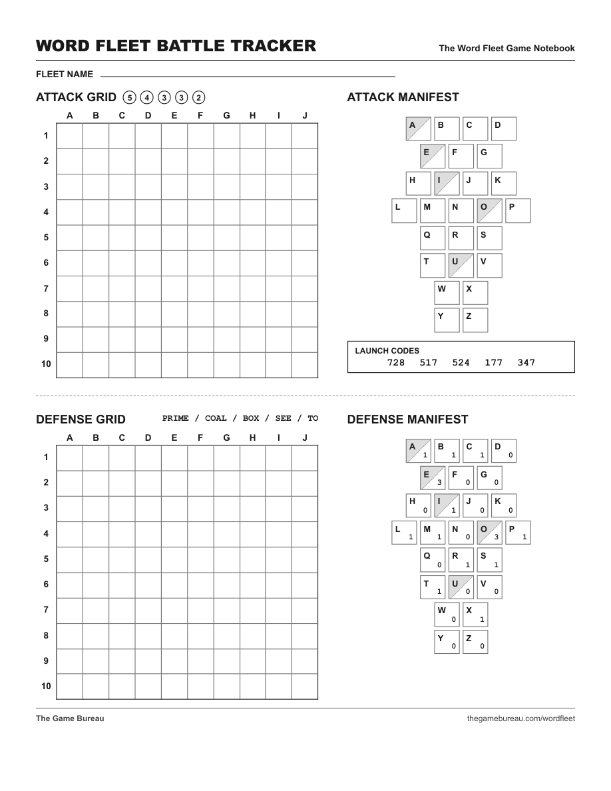

<h1>Rules of Engagement</h1>

2 captains &middot; 15&ndash;30 minutes &middot; Ages 10+

Hide a fleet of five words on your battle sheet. Guess a whole enemy word-ship to earn a shot. Win by naming every word in the opposing fleet and exactly where it is hidden.

<nav class="rule-contents">
<h2>In this guide</h2>
<ol>
  <li><a href="#battle-sheets">Get your battle sheets ready</a></li>
  <li><a href="#deploy">Deploy your word-ships</a></li>
  <li><a href="#first-shot">Decide who goes first</a></li>
  <li><a href="#turns">Take a turn</a></li>
  <li><a href="#surrender">Demand surrender</a></li>
</ol>
</nav>

<h2 id="battle-sheets">Get your battle sheets ready</h2>

Each captain tears a <strong>Battle Tracker</strong> out of the notebook or takes a printed sheet. Keep your words and launch codes hidden from your opponent. Grab a pencil and fill in the <strong>Fleet Name</strong> line.

<dl>
  <dt>Attack Grid</dt>
  <dd>Track your shots and the letters you uncover in your opponent’s fleet.</dd>
  <dt>Attack Manifest</dt>
  <dd>Use these alphabet boxes to keep track of the letter tallies your opponent gives you.</dd>
  <dt>Defense Grid</dt>
  <dd>Hide your own word-ships here.</dd>
  <dt>Defense Manifest</dt>
  <dd>Look here to see how many times each letter appears in your own fleet.</dd>
  <dt>Launch Codes</dt>
  <dd>Use these five secret numbers to bluff for the first turn.</dd>
</dl>
<figure class="rule-pic">
  
  <figcaption>Sample battle sheet</figcaption>
</figure>

<h2 id="deploy">Deploy your word-ships</h2>

Find the five words printed above your Defense Grid. They are <strong>5, 4, 3, 3, and 2 letters</strong> long. Each word is one ship.

<ol>
  <li>Pick a starting square for each word and write one letter per square.</li>
  <li>Place the letters left to right across a row or top to bottom down a column.</li>
  <li>Give each ship its own squares inside the grid. Ships may touch.</li>
</ol>

<aside class="callout">
<strong>Example.</strong> Place MAP across C4, D4, and E4. Write M in C4, A in D4, and P in E4.
</aside>

<h2 id="first-shot">Decide who goes first</h2>

Either captain calls out a three-digit launch code from <strong>000 to 999</strong>. It can be a code printed on their sheet or a bluff. The other captain chooses one response.

<table>
  <thead>
    <tr><th scope="col">Response</th><th scope="col">What happens</th></tr>
  </thead>
  <tbody>
    <tr><th scope="row">Concede</th><td>The captain who called the code takes the first turn.</td></tr>
    <tr><th scope="row">Challenge</th><td>The caller must prove the code appears on their sheet. If it does, the caller goes first. If it was a bluff, the challenger goes first.</td></tr>
    <tr><th scope="row">Counter</th><td>Call an equal or higher code. You become the new caller and the other captain now chooses a response.</td></tr>
  </tbody>
</table>

Keep going until someone concedes or a challenge settles who goes first.

<aside class="callout">
<strong>Example.</strong> You call 850. Your opponent counters with 900. You challenge, and 900 is missing from their sheet. You take the first turn.
</aside>

<h2 id="turns">Take a turn</h2>

Alternate turns. At the start of your turn, choose a standard attack or <a href="#surrender">demand surrender</a>.

<h3>Guess a whole word-ship before you fire</h3>

Say one complete word you think is in your opponent’s fleet. Your opponent checks their word list.

<ul>
  <li><strong>Correct word.</strong> You earn a shot. Call a coordinate to fire.</li>
  <li><strong>Wrong word.</strong> Your turn ends immediately. Pass play to the other captain.</li>
</ul>

<h3>Call a coordinate</h3>

Call a column letter from A to J and a row number from 1 to 10, such as <strong>E7</strong>. Your opponent checks that square on their Defense Grid and calls a hit or a miss.

<ul>
  <li><strong>Miss.</strong> Put a dot in that square on your Attack Grid and pass the turn.</li>
  <li><strong>Hit.</strong> Outline the square on your Attack Grid. Take one guess at the letter in that square.</li>
</ul>

<h3>Guess one letter after a hit</h3>

<ul>
  <li><strong>Correct letter.</strong> Your opponent confirms it. Write the letter in the square and pass the turn.</li>
  <li><strong>Wrong letter.</strong> Your opponent checks their Defense Manifest and tells you how many times the letter you guessed appears across their entire fleet, including letters already found. Record the tally and pass the turn.</li>
</ul>

You can fire at a square you hit before on a later turn to try a different letter.

<aside class="callout">
<strong>Example.</strong> You correctly guess TIDE and earn a shot. You hit E4 and guess A. The square holds P, and A appears twice in the opposing fleet. Your opponent says “A tally 2.” Mark the hit, record the tally, and pass the turn.
</aside>

<h2 id="surrender">Demand surrender</h2>

At the start of your turn, you can demand surrender in place of attacking. Say all five enemy words, their spellings, and the first and last coordinates of each word.

Your opponent waits for you to finish calling the whole fleet, then checks every word and location against their Defense Grid.

<ul>
  <li><strong>Everything is right.</strong> You win immediately.</li>
  <li><strong>Any word, spelling, or location is wrong.</strong> Your opponent wins immediately.</li>
</ul>

<aside class="callout">
<strong>Example.</strong> Call “MAP, M-A-P, from C4 to E4,” then give the same information for the other four word-ships.
</aside>
